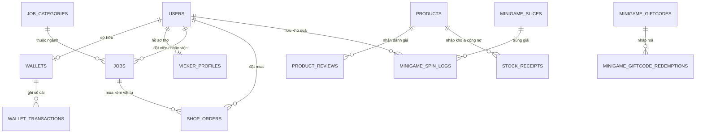

# 🛠️🛍️ VIESHIFT V2 & VIESHIFT MALL — Nền Tảng Đặt Thợ Gia Đình, Thương Mại Điện Tử Vật Tư & Quản Trị Toàn Diện


---

## 📌 1. Giới Thiệu Tổng Quan

**VieShift v2** là hệ sinh thái ứng dụng Web đa dịch vụ kết hợp **Sàn Kết Nối Đặt Thợ Gia Đình Uy Tín (On-Demand Home Services)** và **Trung Tâm Thương Mại Vật Tư & Thiết Bị Gia Đình Chính Hãng (VieShift Mall)** cùng hệ thống **Gamification Vòng Quay May Mắn & Kho Quà Cá Nhân**.

Dự án được xây dựng trên nền tảng **Java 21 + Spring Boot 3.3 + Spring Data JPA (Hibernate) + Thymeleaf + PostgreSQL**, kế thừa và nâng cấp các tinh hoa nghiệp vụ từ hệ thống thương mại điện tử **Minishop (LTW_01)**:

* **Mô hình Kinh doanh Kép (Dual Revenue Stream):** Kết hợp thu phí hoa hồng điều phối thợ lành nghề (**VieKer**) và doanh thu bán lẻ vật tư, thiết bị điện nước, khóa vân tay, phụ kiện lắp đặt (**VieShift Mall**).
* **Linh hoạt Lắp đặt (DIY vs. Thuê Thợ):** Khách mua vật tư có thể chọn **Tự lắp đặt tại nhà (Tiết kiệm 100% phí thợ)** kèm cẩm nang hướng dẫn, hoặc **Đặt kèm Thợ VieKer mang vật tư tới lắp đặt trọn gói**.
* **Định vị Bản đồ GPS & Tính phí Giao hàng Tự động:** Tích hợp bản đồ số **Leaflet + OpenStreetMap + Nominatim Reverse Geocoding** và tính phí vận chuyển tự động theo **Tỉnh/Thành - Quận/Huyện - Phường/Xã** (Miễn phí vận chuyển cho đơn từ `300.000đ`).
* **Bảo mật & Toàn vẹn Dữ liệu Cấp Doanh Nghiệp:** Xác thực **Spring Security 6 + Google OAuth2**, bảo vệ **CSRF Token**, cơ chế **Ví Bảo Đảm (Escrow Wallet)** và **Kiểm toán Toàn vẹn Dữ liệu (HMAC-SHA256 Checksum)** chống can thiệp trái phép vào giá bán, tồn kho và kết quả trúng thưởng.

---

## 🏗️ 2. Kiến Trúc Hệ Thống & Cấu Trúc Thư Mục

Dự án tuân thủ kiến trúc phân tầng chuẩn **Spring Boot MVC + Service + Repository (JPA)**:

```text
VieShift_v2/
│
├── 📂 src/main/java/vn/vieshift/
│   ├── 📂 config/                      # Cấu hình hệ thống & Khởi tạo dữ liệu mẫu
│   │   ├── SecurityConfig.java         # Cấu hình Spring Security 6, Phân quyền RBAC, Google OAuth2
│   │   ├── WebConfig.java              # Cấu hình tài nguyên tĩnh & Upload
│   │   └── DataInitializer.java        # Tự động nạp dữ liệu mẫu (Ngành nghề, Vật tư, Vòng quay, Phiếu nhập)
│   │
│   ├── 📂 controller/                  # Tầng Điều Hướng & Xử Lý Request (Web + REST API)
│   │   ├── HomeController.java         # Trang chủ, Khám phá dịch vụ, Đăng nhập / Đăng ký
│   │   ├── CustomerController.java     # Đặt thợ, Quản lý việc, Ví Bảo Đảm, Đánh giá, Khiếu nại
│   │   ├── ViekerController.java       # Bảng điều khiển Đối tác Thợ, Nhận việc, Chat, Thu nhập
│   │   ├── ShopController.java         # Cửa hàng VieShift Mall, Chi tiết SP, Thanh toán, Hóa đơn A4
│   │   ├── MinigameController.java     # Vòng Quay May Mắn, Kho Quà Cá Nhân, Quy đổi Tiền Ví / Quà 0đ
│   │   ├── PaymentController.java      # Cổng thanh toán trực tuyến VNPAY Sandbox & Callback
│   │   └── AdminController.java        # Trung tâm Quản trị Toàn diện 12 phân hệ (ERP & E-Commerce)
│   │
│   ├── 📂 service/                     # Tầng Xử Lý Nghiệp Vụ (Business Logic Layer)
│   │   ├── ShopService.java            # Nghiệp vụ Bán hàng, Đơn vật tư, Nhập kho, Công nợ, Thùng rác
│   │   ├── MinigameService.java        # Thuật toán Vòng quay trọng số, Giftcode, Quy đổi Kho Quà
│   │   ├── GhnShippingService.java     # Tính phí vận chuyển tự động theo Tỉnh/Quận/Phường
│   │   ├── DataIntegrityService.java   # Kiểm toán & Bảo vệ toàn vẹn dữ liệu HMAC-SHA256
│   │   ├── WalletService.java          # Ví điện tử, Ký quỹ Bảo đảm (Escrow), Hoàn tiền tự động
│   │   ├── JobService.java             # Điều phối đơn đặt thợ, Ghép thợ theo bán kính Km
│   │   ├── VoucherService.java         # Quản lý Mã giảm giá & Khuyến mãi toàn sàn
│   │   └── VnPayService.java           # Tạo URL thanh toán & Xác thực chữ ký số VNPAY
│   │
│   ├── 📂 repository/                  # Tầng Truy Xuất Dữ Liệu (Spring Data JPA Repositories)
│   │   ├── ProductRepository.java, ShopOrderRepository.java, StockReceiptRepository.java...
│   │   ├── MinigameSliceRepository.java, MinigameSpinLogRepository.java, MinigameGiftcodeRepository.java...
│   │   └── UserRepository.java, JobRepository.java, WalletRepository.java, VoucherRepository.java...
│   │
│   └── 📂 entity/                      # Tầng Thực Thể Cơ Sở Dữ Liệu (JPA Entities)
│       ├── Product.java, ShopOrder.java, StockReceipt.java, ProductReview.java
│       ├── MinigameSlice.java, MinigameSpinLog.java, MinigameGiftcode.java
│       └── User.java, ViekerProfile.java, Job.java,JobCategory.java, Wallet.java, Voucher.java...
│
├── 📂 src/main/resources/
│   ├── 📂 static/                      # Tài nguyên tĩnh Frontend
│   │   ├── 📂 css/vieshift.css         # Bộ quy chuẩn thiết kế giao diện thương mại hiện đại
│   │   └── 📂 media/minigame/          # Hệ thống âm thanh 8-Bit BGM & SFX (Quay, Trúng Voucher, Trúng Quà)
│   │
│   ├── 📂 templates/                   # Giao diện người dùng Thymeleaf HTML5
│   │   ├── index.html                  # Trang chủ Đặt thợ & Khám phá dịch vụ
│   │   ├── shop.html                   # Cửa hàng Vật tư VieShift Mall (Giỏ hàng, Yêu thích, Đơn mua)
│   │   ├── shop-product-detail.html    # Chi tiết Sản phẩm, Đánh giá thực tế & Phản hồi Cửa hàng
│   │   ├── shop-checkout.html          # Trang Thanh toán (Tỉnh/Quận/Phường, GPS, Ví/COD/VNPAY)
│   │   ├── shop-invoice.html           # Hóa đơn Bán lẻ & Phiếu Xuất Kho chuẩn A4
│   │   ├── minigame.html               # Vòng Quay May Mắn, Kho Quà Cá Nhân & Quy Đổi Giải Thưởng
│   │   ├── 📂 customer/                # Dashboard Khách hàng, Ví Bảo Đảm, Hóa đơn dịch vụ
│   │   ├── 📂 vieker/                  # Dashboard Đối tác Thợ VieKer & Hồ sơ năng lực
│   │   └── 📂 admin/dashboard.html     # Hệ thống Quản trị Admin 12 Tab chuyên sâu
│   │
│   └── application.properties          # Cấu hình kết nối PostgreSQL, VNPAY, Mail, Bảo mật
│
├── pom.xml                             # Cấu hình phụ thuộc Maven
├── run_app.bat                         # Script khởi chạy nhanh hệ thống
└── push_github.bat                     # Script đồng bộ & đẩy mã nguồn lên GitHub
```

---

## 🗄️ 3. Thiết Kế Cơ Sở Dữ Liệu (Database Schema)

Hệ thống sử dụng cơ sở dữ liệu quan hệ **PostgreSQL (`vieshift_db`)** gồm 18 bảng liên kết chặt chẽ giữa **Dịch vụ Đặt Thợ**, **Thương mại Vật tư**, **Ví Điện Tử** và **Minigame**:



### 📋 Chi tiết các bảng CSDL cốt lõi:

| Bảng CSDL | Khóa chính / Khóa ngoại | Chức năng & Các trường dữ liệu nổi bật |
| :--- | :--- | :--- |
| **`users`** | `id` (PK) | `email` (Unique), `password` (BCrypt), `full_name`, `phone`, `role` (`CUSTOMER`, `VIEKER`, `ADMIN`), `active` |
| **`wallets`** | `id` (PK), `user_id` (FK) | `balance` (Số dư khả dụng), `locked_balance` (Số dư ký quỹ bảo đảm đơn việc) |
| **`wallet_transactions`** | `id` (PK), `wallet_id` (FK) | `amount`, `type` (`DEPOSIT`, `WITHDRAW`, `ESCROW_HOLD`, `ESCROW_RELEASE`, `SHOP_PURCHASE`, `SHOP_REFUND`), `balance_after` |
| **`jobs`** | `id` (PK), `customer_id`, `vieker_id` | `title`, `address`, `latitude`, `longitude`, `price`, `status` (`OPEN` -> `ACCEPTED` -> `IN_PROGRESS` -> `COMPLETED`), `voucher_code` |
| **`shop_products`** | `id` (PK) | `name`, `category`, `related_service_category`, `price`, `original_price`, `stock_quantity`, `sold_count`, `unit`, `deleted` (Soft-delete), `checksum` |
| **`shop_orders`** | `id` (PK), `customer_id`, `related_job_id` | `order_type` (`STANDALONE`, `WITH_JOB`), `items_summary`, `subtotal_amount`, `shipping_fee`, `discount_amount`, `total_amount`, `payment_method` (`WALLET`, `COD`, `VNPAY`), `status` |
| **`stock_receipts`** | `id` (PK), `product_id` (FK) | `receipt_code`, `supplier_name`, `quantity`, `import_price`, `total_cost`, `paid_amount`, `debt_amount` — Quản lý phiếu nhập kho & công nợ nhà cung cấp |
| **`product_reviews`** | `id` (PK), `product_id` (FK) | `reviewer_name`, `rating` (1–5 sao), `comment`, `verified_purchase`, `admin_reply` (Phản hồi từ cửa hàng), `visible` |
| **`minigame_slices`** | `id` (PK) | `label`, `type` (`COUPON`, `GIFT`, `MISS`), `reward_value`, `coupon_code`, `win_rate` (% trọng số), `color`, `slice_index` |
| **`minigame_spin_logs`** | `id` (PK), `user_id`, `slice_id` | `phone`, `reward_type`, `reward_detail`, `claimed` (Trạng thái nhận quà), `claim_method` (`WALLET`, `SHIP_GIFT`), `claimed_note`, `checksum` |
| **`minigame_giftcodes`** | `id` (PK) | `code`, `spin_count` (Số lượt tặng), `max_uses`, `used_count`, `active` |
| **`vouchers`** | `id` (PK) | `code`, `title`, `discount_type` (`PERCENTAGE`, `FIXED_AMOUNT`), `discount_value`, `min_order_amount`, `is_public`, `active` |

---

## 🌟 4. Các Tính Năng Đột Phá Trên Hệ Thống

### 🛍️ 4.1. Trung Tâm Vật Tư & Thiết Bị Gia Đình — VieShift Mall (`/shop`)
1. **Mua Lẻ Tự Lắp (DIY) hoặc Đặt Kèm Thợ Lắp Đặt Trọn Gói:**
   * Khách hàng có thể mua lẻ vật tư về tự lắp kèm **Cẩm nang hướng dẫn tự lắp đặt tại nhà** để tiết kiệm 100% chi phí thuê thợ.
   * Hoặc chọn **"Cần thợ hỗ trợ lắp"** ngay trên trang thanh toán hoặc tích chọn mua kèm vật tư ngay trong lúc đặt lịch thuê thợ.
2. **Định Vị GPS & Tính Phí Giao Hàng Tự Động Theo Tỉnh / Quận / Phường:**
   * Tự động nạp danh sách Tỉnh/Thành phố, Quận/Huyện, Phường/Xã và tính phí giao hàng theo khu vực.
   * Nút **"Định vị GPS của tôi"** tự động điền địa chỉ nhận hàng chính xác từ tọa độ thực tế.
   * Tự động **Miễn phí vận chuyển (Freeship 0đ)** cho mọi đơn hàng từ `300.000đ` hoặc đơn có Thợ VieKer mang theo.
3. **3 Phương Thức Thanh Toán & Thanh Toán Lại (Repay VNPAY):**
   * Hỗ trợ thanh toán qua **Ví Bảo Đảm VieShift** (hoàn tiền tự động 100% ngay lập tức nếu hủy đơn), **Tiền mặt khi nhận hàng (COD)**, và **Cổng VNPAY Online**.
   * Hỗ trợ nút **"Thanh toán lại VNPAY"** ngay trong lịch sử đơn hàng nếu khách lỡ đóng trình duyệt khi đang thanh toán.
4. **Danh Sách Yêu Thích (Wishlist), Đánh Giá Thực Tế & Xuất Hóa Đơn A4:**
   * Lưu sản phẩm yêu thích, gửi đánh giá 5 sao (kèm huy hiệu *Đã mua hàng*) và xem phản hồi chính thức từ **VieShift Mall**.
   * Xuất và in **Hóa Đơn Bán Lẻ & Phiếu Xuất Kho chuẩn A4** (`/shop/orders/{id}/invoice`).

---

### 🎡 4.2. Vòng Quay May Mắn & Kho Quà Cá Nhân Quy Đổi 1-Chạm (`/minigame`)
1. **Vòng Quay Canvas 2D & Âm Thanh 8-Bit Sống Động:**
   * Vòng quay 8 ô giải thưởng hoạt động bằng thuật toán xác suất trọng số (`Weighted Random`) xử lý hoàn toàn trên Backend.
   * Tích hợp bộ âm thanh 8-Bit: Nhạc nền sự kiện, tiếng kim chỉ cạch cạch khi quay, âm thanh pháo hoa khi trúng Voucher hoặc Quà hiện vật.
2. **Tích Lũy Lượt Quay Đa Kênh & Nhập Mã Giftcode:**
   * Tự động cộng lượt quay khi khách hoàn thành đơn thuê thợ (`+1`), đặt mua vật tư tại VieShift Mall (`+1`), đánh giá chất lượng (`+1`), hoặc nhập mã Giftcode sự kiện (`VIESHIFT2026`, `MAYMAN88`, `THOVIET`, `REVIEWVIP`).
3. **Kho Quà Cá Nhân & Trung Tâm Quy Đổi Giải Thưởng (`#my-prize-vault`):**
   * Lưu trữ đầy đủ lịch sử trúng thưởng của từng khách hàng ngay dưới vòng quay.
   * **Với Giải Quà Hiện Vật (`GIFT`):** Khách hàng có thể bấm **"🚚 Nhận Hiện Vật 0đ (Giao tận nhà)"** để tạo ngay đơn hàng `0đ` giao miễn phí tận nơi, HOẶC bấm **"💰 Đổi Tiền Vào Ví"** để quy đổi 100% giá trị phần quà cộng thẳng vào số dư **Ví Bảo Đảm VieShift**.
   * **Với Giải Mã Giảm Giá (`COUPON`):** Tự động kích hoạt mã Voucher để áp dụng giảm trừ trực tiếp tại trang Thanh toán (`/shop/checkout`), hoặc bấm **"💰 Quy Đổi Vào Ví"** để cộng tiền thưởng trực tiếp vào Ví.

---

### 🛡️ 4.3. Hệ Thống Quản Trị Đa Phân Hệ (Admin Dashboard — `/admin`)
Trang Quản trị (`/admin`) gồm **12 phân hệ chuyên sâu** hợp nhất giữa điều phối dịch vụ và quản trị bán lẻ:
1. **Tổng quan Vận hành (`overview`) & Phân tích Tăng trưởng (`analytics`):** Biểu đồ doanh thu, tỷ lệ hoàn thành đơn và phân bổ danh mục.
2. **Xét duyệt Hồ sơ Đối tác VieKer (`viekers`) & Xử lý Khiếu nại (`disputes`):** Duyệt CCCD/chứng chỉ thợ và phân xử hoàn tiền/giải ngân ký quỹ.
3. **Quản lý Đơn Đặt Thợ (`jobs`), Ngành Nghề (`categories`), Thành Viên (`users`), Sổ Cái Dòng Tiền (`transactions`) & Voucher (`vouchers`).**
4. **Quản trị VieShift Mall, Kho Hàng, Công Nợ & Đánh Giá (`shop`):**
   * **CRUD Sản phẩm & Thùng rác Khôi phục (Soft-Delete Trash):** Thêm mới, chỉnh sửa bằng Modal, tạm ẩn/mở bán, xóa mềm vào thùng rác và khôi phục lên kệ.
   * **Lập Phiếu Nhập Kho & Quản lý Công Nợ Nhà Cung Cấp:** Tự động cộng số lượng tồn kho, tính tổng tiền nhập, số tiền đã trả trước, công nợ còn lại và hỗ trợ **Trả nợ từng đợt / Tất toán công nợ**.
   * **Quản lý Đánh giá & Phản hồi Cửa hàng:** Trả lời trực tiếp từng đánh giá của khách hàng trên trang sản phẩm.
5. **Quản trị Vòng Quay May Mắn & Giftcode (`minigame`):** Chỉnh sửa trực tiếp tên giải thưởng, tỷ lệ trúng (`%`), mệnh giá thưởng của 8 ô vòng quay và phát hành mã Giftcode mới.
6. **Kiểm toán Hệ thống & Bảo vệ Giá bán (`security`):** Tự động đối soát tính toàn vẹn của toàn bộ bảng giá vật tư, số lượng tồn kho và lịch sử trúng thưởng.

---

## 💻 5. Hướng Dẫn Cài Đặt & Chạy Dự Án

### ⚙️ Yêu Cầu Môi Trường:
* **Java Development Kit (JDK):** Phiên bản **21 LTS** trở lên
* **Build Tool:** Apache Maven **3.9+**
* **Cơ sở dữ liệu:** **PostgreSQL 15+** (mặc định cổng `5432`, database `vieshift_db`)

### 🚀 Các bước khởi chạy nhanh:

1. **Clone dự án từ GitHub:**
   ```bash
   git clone https://github.com/lethanhphivu04-lgtm/VieShift_v2.git
   cd VieShift_v2
   ```

2. **Cấu hình Cơ Sở Dữ Liệu PostgreSQL:**
   * Tạo database trống tên `vieshift_db` trong PostgreSQL.
   * Kiểm tra thông tin kết nối tại tệp `src/main/resources/application.properties`:
     ```properties
     spring.datasource.url=jdbc:postgresql://localhost:5432/vieshift_db
     spring.datasource.username=postgres
     spring.datasource.password=vieshift123
     ```
   * *(Hệ thống sẽ tự động khởi tạo toàn bộ bảng và nạp dữ liệu mẫu thông qua `DataInitializer.java` ngay trong lần chạy đầu tiên).*

3. **Biên dịch và Khởi chạy ứng dụng:**
   * Chạy trực tiếp bằng tệp thực thi tự động:
     ```bat
     run_app.bat
     ```
   * Hoặc chạy qua lệnh Maven:
     ```bash
     mvn spring-boot:run
     ```

4. **Các đường dẫn truy cập chính:**
   * 🌐 **Trang chủ Đặt Thợ & Dịch vụ:** `http://localhost:8080/`
   * 🛍️ **Cửa hàng Vật tư VieShift Mall:** `http://localhost:8080/shop`
   * 🎡 **Vòng Quay May Mắn & Kho Quà:** `http://localhost:8080/minigame`
   * 🛡️ **Trung tâm Quản trị Admin:** `http://localhost:8080/admin`

---

## 🔑 6. Tài Khoản Đăng Nhập Kiểm Thử Mặc Định

Hệ thống đã khởi tạo sẵn các tài khoản mẫu (kèm số dư Ví Bảo Đảm `1.500.000đ` để trải nghiệm đặt thợ và mua sắm ngay):

| Vai trò | Email đăng nhập | Mật khẩu | Quyền hạn & Trải nghiệm |
| :--- | :--- | :--- | :--- |
| **Quản trị viên (Admin)** | `admin@vieshift.vn` | `admin123` | Toàn quyền quản trị 12 phân hệ: Duyệt thợ, Quản lý kho & Công nợ, Vòng quay, Kiểm toán |
| **Khách hàng (Customer)** | `khachhang@vieshift.vn` | `khach123` | Đặt thợ, Mua vật tư VieShift Mall, Quay thưởng & Quy đổi quà, Quản lý Ví Bảo Đảm (`1.500.000đ`) |
| **Đối tác Thợ (VieKer)** | `vieker@vieshift.vn` | `vieker123` | Nhận việc theo bán kính, Chat với khách, Cập nhật tiến độ công việc, Rút thu nhập |

---

## 👨‍💻 7. Tác Giả & Bản Quyền

* **Tác giả:** Lê Thanh Phi Vũ
* **Kho lưu trữ gốc tham khảo:** [LTW_01 (Minishop)](https://github.com/lethanhphivu04-lgtm/LTW_01) & [VieShift_v2](https://github.com/lethanhphivu04-lgtm/VieShift_v2)
* **Bản quyền:** Phát hành theo giấy phép mã nguồn mở **MIT License**.
